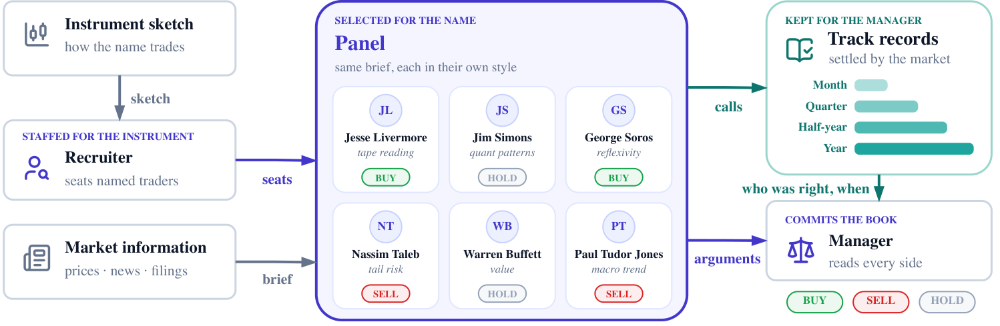

# FinPanel

Reference implementation of the paper **Who Should Be on the Panel? Task-Conditioned Persona Selection for LLM Trading Agents**.

FinPanel is an LLM multi-agent trading system that staffs a panel of named trader personas for each stock the way a trading desk does. A *recruiter* reads a direction-blind statistical sketch of how the stock trades and seats *N* named real traders suited to it; every trading day each *trader* reads the same brief and gives an independent call (BUY / SELL / HOLD) with an argument, in its own style; a *distiller* settles each call against the next day's market and maintains a hierarchical track record (month / quarter / half-year / year) for each trader; a *manager* reads the arguments and the records and commits the portfolio to one action. Nothing is returned to the traders, so the panel can start on a new stock from an empty record.



The same engine also runs the baselines compared in the paper: FinMem, FinAgent and TradingAgents (re-implemented with their public prompt sets), the FINSABER rule-based strategies, ARIMA / XGBoost predictors, and the A2C / PPO / SAC / TD3 agents.

## Layout

```
src/
  finpanel/        recruiter (panel.py), traders (actors/), distiller.py, manager and the daily workflow
  baselines/       FinMem, FinAgent, TradingAgents, rule-based, predictor and RL baselines
  backtest/        execution engine (next-open fills, commission and slippage), run artefacts
  data/            frozen price / news / filings access, news retrieval, fundamentals briefs
  llm/             providers, deterministic call cache, tag parsing
  main.py          command-line entry point (`backtest`)
prompts/           every LLM prompt, as YAML templates (finpanel/, finmem/, finagent/, tradingagents/)
configs/           base.yaml (run settings), models.yaml (backbones), chat template for gpt-oss
tools/             data preparation (see below)
```

## Setup

Python 3.12+ and [uv](https://docs.astral.sh/uv/).

```bash
uv sync                      # creates .venv with the dependencies in pyproject.toml
cp .env.example .env         # fill in the API key(s) of the backbones you use
```

Backbones are declared in `configs/models.yaml`. The paper uses `gpt-oss-120b` served locally through an OpenAI-compatible endpoint (`http://127.0.0.1:30000/v1`, key `LOCAL_API_KEY`; start the server with `--chat-template configs/gpt-oss-chat-template.jinja` so that the model's system date is the simulated trading day) and `gpt-4o-mini-2024-07-18` through the OpenAI API. All calls run at temperature 0 with a fixed seed.

## Data

The experiments use the FINSABER-V2 data release (daily bars, news and filings). Three steps build the frozen inputs under `data/`:

```bash
# 1. prices, news and filings for the eight stocks, 2020 onwards, as one pickle
uv run python tools/build_selected_dataset.py --download \
  --tickers TSLA NFLX AMZN MSFT GS WMT BA XOM \
  --output data/stock_data_selected8_2020_2025_finsaberv2.pkl

# 2. news: embed the headlines once (text-embedding-ada-002), then select the top-5 per day over a 7-day window
uv run python tools/preprocess_news.py --start 2023-01-01 --end 2025-12-31

# 3. filings: one short brief per 10-K / 10-Q
uv run python tools/summarize_filings.py
```

Steps 2 and 3 need `OPENAI_API_KEY`. The outputs (`news_selection.jsonl`, `fundamentals_briefs.jsonl`) are shared by every method.

## Running

A run trades one stock with one portfolio over a named window (`2025h1` or `2025`), after a training and warm-up segment that starts at `--warmup-start`.

```bash
# FinPanel, N = 6 (configs/base.yaml), two-year warm-up, full year 2025
uv run backtest --strategy finpanel --period 2025 --tickers TSLA \
  --warmup-start 2023-01-01 --model-name gpt-oss-120b

# panel size is a command-line override
uv run backtest --strategy finpanel --set panel_size=4 --period 2025 --tickers TSLA \
  --warmup-start 2023-01-01 --model-name gpt-oss-120b

# LLM baselines on the same engine, inputs and costs
uv run backtest --strategy finmem,finagent,tradingagents --period 2025 --tickers TSLA \
  --warmup-start 2023-01-01 --model-name gpt-oss-120b

# classic baselines
uv run backtest --strategy buy_and_hold,sma_cross,wma_cross,bollinger_bands,trend_following,atr_band,turn_of_the_month \
  --period 2025 --tickers TSLA --warmup-start 2023-01-01
uv run backtest --strategy arima,xgboost --period 2025 --tickers TSLA --warmup-start 2023-01-01
uv run backtest --strategy a2c,ppo,sac,td3 --period 2025 --tickers TSLA --warmup-start 2023-01-01   # Linux only
```

`--tickers` takes a comma-separated list. Every run writes its artefacts under `results/`: the daily equity curve, the summary metrics (cumulative return, Sharpe, Sortino, maximum drawdown), every LLM call with its raw reply, and, for FinPanel, `panel.yaml` (the recruited panel with the sketch it was recruited from) and a per-day record of every trader's call and the manager's action. `uv run backtest --help` lists all options.

### Ablations

Each ablation in the paper is the standing system with one component removed, run through the same entry point:

| Arm | How |
|---|---|
| w/o selection (the same fixed panel on every stock) | `--set "panel_roster=Jim Simons,Paul Tudor Jones,George Soros,Richard Dennis,Jesse Livermore,Warren Buffett"` |
| w/o sketch (the recruiter sees the ticker only) | `--set panel_blind=true` |
| w/o warm-up (empty record at the start) | omit `--warmup-start` and pass `--set train_start=2023-01-01`, so the recruiter still reads the same training segment while the record starts with the window |
| w/o record (the manager reads arguments only) | `--set use_records=false` |
| panel size | `--set panel_size=1`, `4`, `8` |

Because a trader's daily prompt does not depend on the panel or on any record, traders shared between arms reuse their archived calls (`--cache-from CODE` inherits the LLM cache of an earlier run), so every ablation is paired on identical trader calls.

## License

MIT.
